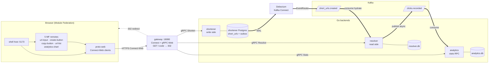

# unnecessary complexity

A URL shortener that didn't need any of this.

It's an event-sourced, multi-language, multi-process system with Kafka, Debezium, gRPC, Module Federation, a Postgres database and two SQLite ones, six frontend apps, kind/Kustomize manifests, and a build-tagged integration suite. The problem it solves fits in fifty lines of any language. That's the joke.

It's also the point. Every pattern engineers argue about — write/read separation, event sourcing, eventual consistency, micro-frontends, Connect/gRPC, multi-module Go workspaces — is wired up in a problem small enough to read in an afternoon. Each piece can be lifted out and reasoned about on its own.

## Architecture



- **Solid arrows**: synchronous RPC over Connect/gRPC.
- **Dashed arrow**: the `GET /:code` 302 redirect.
- **Thick arrows**: async Kafka events.
- **Cylinders**: each backend's own store. Independent stores. Resolver and analytics are eventually consistent with shortener.

## What's in it

**Backend**: Go workspace, four services, two shared modules.

- `services/shortener`: write side. Owns the canonical Postgres store. Every insert writes a `ShortURLCreated` outbox row in the same transaction. Debezium reads it from the WAL and publishes it to `short_urls.created`. The shortener has no Kafka client.
- `services/resolver`: read side. Hydrated from Kafka into its own SQLite. Fires `clicks.recorded` async on every resolve (5s timeout, separate context).
- `services/analytics`: consumes `clicks.recorded` into a clicks fact table. Exposes a `Stats` RPC with daily aggregation and date filters.
- `services/gateway`: HTTP/Connect/gRPC-Web front door. Holds gRPC clients to all three backends. Also owns the `GET /<code>` 302 redirect. The resolver serves the same redirect directly on `RESOLVER_HTTP_ADDR`.
- `services/platform-events`: Kafka publisher (`segmentio/kafka-go`), generic typed consumer, in-memory fakes for tests, topic constants.
- `services/proto`: generated Connect/gRPC stubs. Single source of truth, never edited by hand.

**Frontend**: pnpm workspace under `frontend/`, Module Federation at runtime.

- `apps/shell` is the host. Five remotes (`mf-url-input`, `mf-create-button`, `mf-copy-button`, `mf-url-list`, `mf-analytics-chart`) ship independently and share React/ReactDOM/React Router as singletons.
- `packages/proto-web` exports a `createClients({baseUrl})` factory that returns Connect-Web clients. Every component accepts an injectable `clients` prop so tests can swap fakes in.

**Infra & tooling**: Kustomize manifests in `k8s/base`, a `kind` cluster up/down script, and a Tiltfile for local dev. `tilt up` runs Kafka, Postgres and Kafka Connect (Debezium) from `compose.yaml`, and runs the Go backends and the frontend dev servers on the host. Each Go service restarts when its code changes.

**Tests**: unit tests in each Go module. `tests/integration` is gated behind the `integration` build tag so `make ci` never tries to compile it.

## Run it

One-time setup, then bring the local stack up:

```bash
make tools             # installs buf, protoc plugins, golangci-lint
make proto             # regenerate stubs (run after editing .proto)
tilt up                # infra + backends + frontend dev servers. UI at http://localhost:10350
tilt down              # stop everything (compose volumes are kept)
```

Then open `http://localhost:5173`. Short links resolve via the gateway at `http://localhost:18080/<code>`.

CI-equivalent and end-to-end checks:

```bash
make ci                # buf lint + golangci-lint + go test -race + go build (needs Docker for the test Postgres)
make integration-test  # spins up kind, deploys, port-forwards, runs e2e, tears down
```

`tilt up -- --frontend=minimal` runs only the shell and `mf-url-input`, and `--frontend=none` runs no frontend. Install Tilt with `brew install tilt`. The resolver and analytics SQLite files live in `.run/data/` (gitignored).

## Watch it and drive it

The kind cluster can run Prometheus, kube-state-metrics, Loki, Grafana Alloy and Grafana, from `k8s/observability`. The Go services expose `/metrics` on `METRICS_ADDR`:
- gRPC latency per method and code;
- HTTP latency per route;
- Kafka consume results and handler latency;
- the Go runtime.

The **URL shortener** Grafana dashboard covers traffic, p50/p95/p99 latency, errors, the event pipeline, the Go runtime, pod and node CPU and memory, restarts, deployment health, and logs with error counts per app.

```bash
make k8s-up            # kind images + app + observability (or: make obs-up on a running cluster)
make grafana           # port-forward, then open http://localhost:3000 (no login)
make simulate          # simulated users from this machine, through the ingress
```

`make simulate` runs `services/loadgen/cmd/simulate`. Each simulated user shortens links, some with an idempotency key, and sometimes replays the same request as a double submit. It clicks links, most often the newest ones, but only once a link is 2 seconds old. It also reads stats and looks codes up, with a random pause between actions. It sends every request to `localhost:80` with the `url-shortener.local` Host header, so you need no `/etc/hosts` entry or port-forward. It prints ok/miss/error counts and p50/p95 latency per action, every 10 seconds. Pass flags with `SIM_ARGS="-users 100 -duration 5m"`.

`make simulate-chaos` makes the traffic irregular:
- **Drift:** the crowd size drifts at random around `-users`.
- **Spikes:** about once every 45 seconds, a flash crowd arrives at 3 to 8 times the baseline for 10 to 40 seconds, capped by `-max-users`. During a spike, 70% of clicks go to one viral link.
- **Lulls:** about once every 90 seconds, traffic drops close to zero for 10 to 30 seconds.
- **Personas:** each user is a clicker, a creator or an analyst, with its own action mix and pace. About 6% are abusers, who mostly send invalid requests.
- **Attacks:** about once every 2 minutes, for 10 to 25 seconds, 30% of every user's actions are invalid requests.

The invalid requests cover 18 probes: bad URLs, oversized fields, NUL bytes, malformed JSON, the wrong content type or HTTP method, unknown procedures, bad dates, unknown codes, path traversal and a 256KB body. Each one must get a 4xx. A 2xx (a validation hole) or a 5xx (a crash path) prints a `[bad]` line that names the probe.

The simulator prints each phase change as a `[chaos]` line, so you can match it to the dashboard. Against Tilt, use `SIM_ARGS="-target http://localhost:8080 -host ''"`.

## Things worth reading

- **Idempotency contract** (`services/shortener/internal/service`). No key → fresh row every call. Same `(owner_id, idempotency_key)` → returns the previously created row. Same key, different owners → two distinct rows (key is scoped to owner via a partial unique index). Race resolver: the loser catches `ErrDuplicateIdempotencyKey` and re-reads to return the winner's code.
- **Code generation and collisions**. Codes are random 8-char base62 from `crypto/rand` — not a hash of the URL, so the same long URL gives a different code each call (unless an idempotency key says otherwise). The `code` column is a primary key, so a collision on insert raises `ErrDuplicateCode`; `Shorten` catches it, regenerates, and retries up to `maxRetries`. After that, the request fails with `Internal: exhausted code-generation retries`. At length 8 the space is ~2.18×10¹⁴ — this is a teaching loop more than a real concern.
- **Outbox + CDC hop**. The shortener inserts the row and an `outbox` row in one transaction, then deletes the outbox row before commit. The insert is still in the WAL. Debezium's EventRouter turns it into a `short_urls.created` message keyed by code, with the proto event as the value. No dual write: an event exists if and only if the row committed. Delivery is at least once, and the resolver upsert is idempotent. Resolver and analytics catch up via Kafka. Integration tests use `require.Eventually` with `INTEGRATION_PROPAGATION_TIMEOUT` (default 30s).
- **MF async-bootstrap split**. `apps/shell/src/index.tsx` is one line: `import('./bootstrap.js')`. The real `createRoot(...).render(<App />)` lives in `bootstrap.tsx`. Without the split, Module Federation throws `RUNTIME-006` and renders a blank page — shared singletons can't satisfy a synchronous import before the federation runtime initialises.
- **Kafka topic creation**. The `apache/kafka:3.7.0` image doesn't auto-create topics on first publish, despite `KAFKA_AUTO_CREATE_TOPICS_ENABLE=true`. The `kafka-topics` resource in the Tiltfile pre-creates `short_urls.created` and `clicks.recorded`. k8s does the same in the `kafka-topics` Job in `k8s/base/kafka/kafka.yaml`. New topic? Register it in `services/platform-events/events/topics.go`, in the Tiltfile's `kafka-topics` resource, and in that Job.

`CLAUDE.md` has the long version of all the conventions, including the build-tag layout, generated-stub policy, and a Vitest gotcha for the clipboard tests.

## Why

It's easier to teach a hard pattern in a small problem than in a real one. The smallness is what makes the parts visible.
